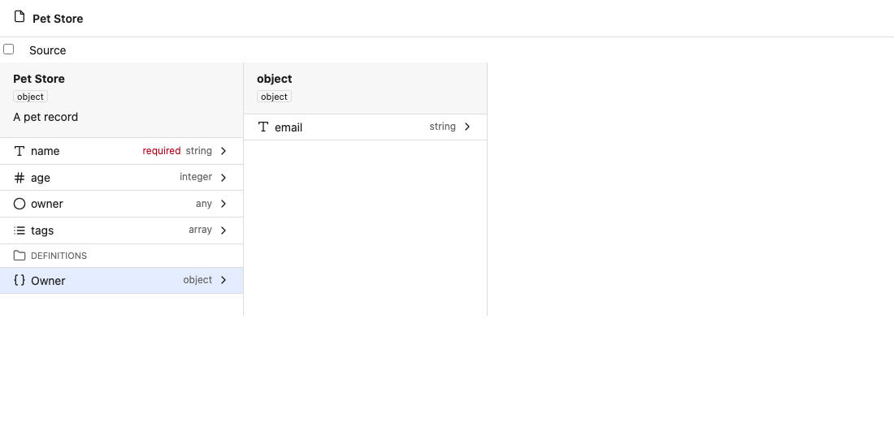

# json-schema-explorer

Turn any JSON Schema into a single, self-contained, offline HTML page: a column-by-column Explorer plus a syntax-highlighted Source view.



## Install

Requires Python 3.14 or newer.

```bash
uv tool install json-schema-explorer
# or
pipx install json-schema-explorer
```

## Usage

```bash
json-schema-explorer build SCHEMA [-o FILE] [--allow-remote] [--ref-root DIR]
```

`SCHEMA` is a file path, an `http(s)` URL, or `-` for stdin. JSON only (no YAML).

| Option | Description |
| --- | --- |
| `-o`, `--output FILE` | Output file. Defaults to `<schema-stem>.html`; stdin gives `schema.html`; a URL uses its last path segment's stem, falling back to `schema.html`. An existing file is overwritten. |
| `--allow-remote` | Fetch remote `http(s)` `$ref`s (about 10 s timeout). Off by default, even when the root schema itself came from a URL. Fetching a root URL never needs this flag. |
| `--ref-root DIR` | Allow local file `$ref`s anywhere under `DIR`. By default they must stay inside the root schema's directory. Local file refs are not followed when the root is a URL or stdin. |

Examples:

```bash
json-schema-explorer build schema.json                  # writes schema.html
json-schema-explorer build https://example.com/s.json -o docs/s.html
cat schema.json | json-schema-explorer build -          # writes schema.html
json-schema-explorer build api/root.json --ref-root .   # allow refs outside api/
json-schema-explorer build root.json --allow-remote     # fetch remote $refs
```

Referenced content is embedded in the output page, which is why remote and out-of-directory refs are opt-in: the page may be published.

### Exit codes and warnings

- Exit 1 with one line on stderr: root file not found, root URL unfetchable, invalid JSON, or a root that is neither an object nor a boolean.
- An unresolvable `$ref` is not fatal: a warning goes to stderr, the Explorer shows a red "unresolved" row, and the exit code is 0.

## Credits

Inspired by `oc-schema-explorer` from [opencollection-dev/opencollection](https://github.com/opencollection-dev/opencollection). This is an independent, clean-room rewrite; no upstream code, CSS, or class names are used. The credit is not a license claim.

Icons are from [lucide](https://lucide.dev) (ISC license); see [LICENSE](LICENSE).

## License

MIT. See [LICENSE](LICENSE).
